# synthuniverse

Site synthwave em HTML, CSS e JavaScript puros, sem bibliotecas e sem etapa de build.

1. **Retrato.** Uma mulher de pele azulada, desenhada em traço de nanquim, sorri, pisca e olha para você.
2. **Cosmos.** Ao clicar em "Entrar no universo", ela se dissolve em estrelas e surge uma paisagem synthwave com sol listrado, montanhas e grade neon.
3. **Universo infinito.** A câmera decola e passam sozinhos, no ritmo da música, **10 cenários synthwave**: Rodovia Neon, Metrópole Neon, Praia das Palmeiras, Oceano Digital, Voo sobre as Montanhas, Túnel Hiperespaço, Planeta Gigante, Deserto das Pirâmides, Aurora Glacial e Constelação do Retrato. Depois do décimo, eles recomeçam com novas cores e outro tom. Não há escolha de cenário: tudo roda sozinho entre **Entrar no universo** e **Reiniciar**.

A trilha sonora é sintetizada em tempo real com a Web Audio API e sincronizada com as animações.

## Galeria

### Retrato e transição

| Retrato | Saída de cena |
|---|---|
| 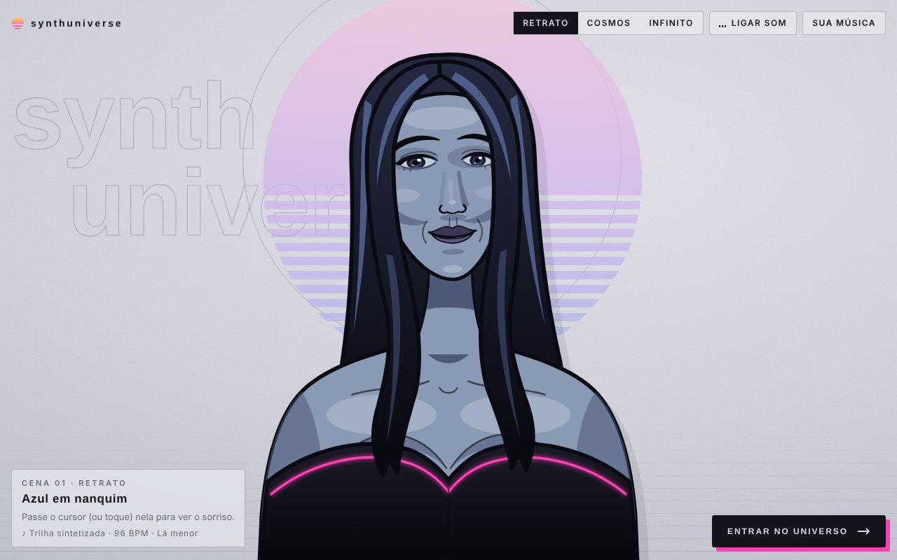 | 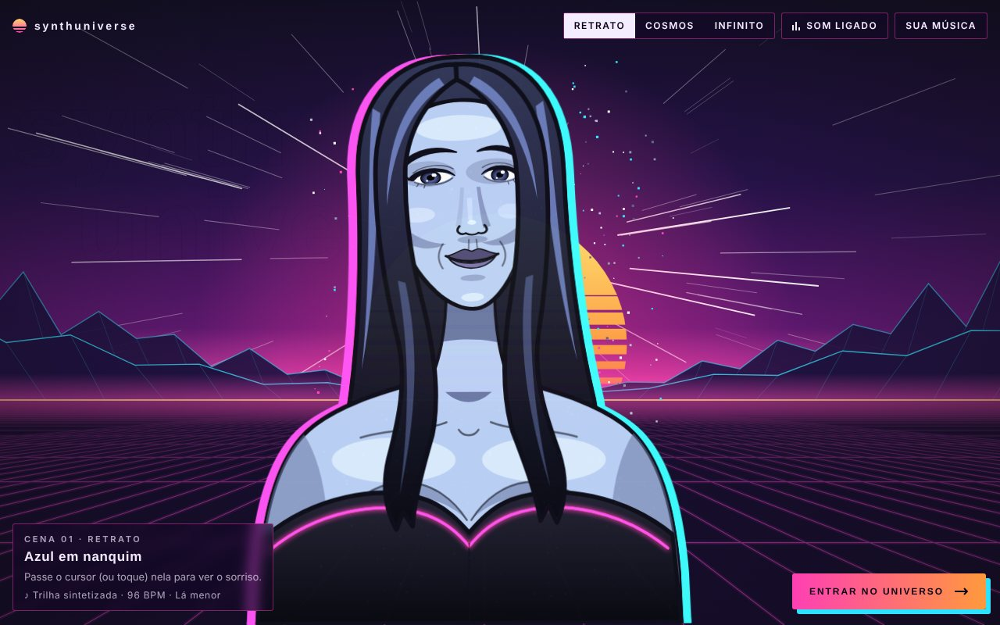 |
| Ela sorri, pisca e olha para você. | Ao clicar em "Entrar no universo", ela sofre um glitch neon e se dissolve em estrelas. |

### Cosmos

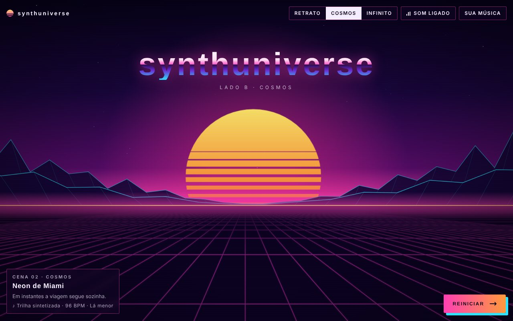

### Universo infinito: os 10 cenários

Eles passam sozinhos, nesta ordem, no ritmo da música, e recomeçam com novas cores depois do décimo.

|   |   |
|---|---|
| 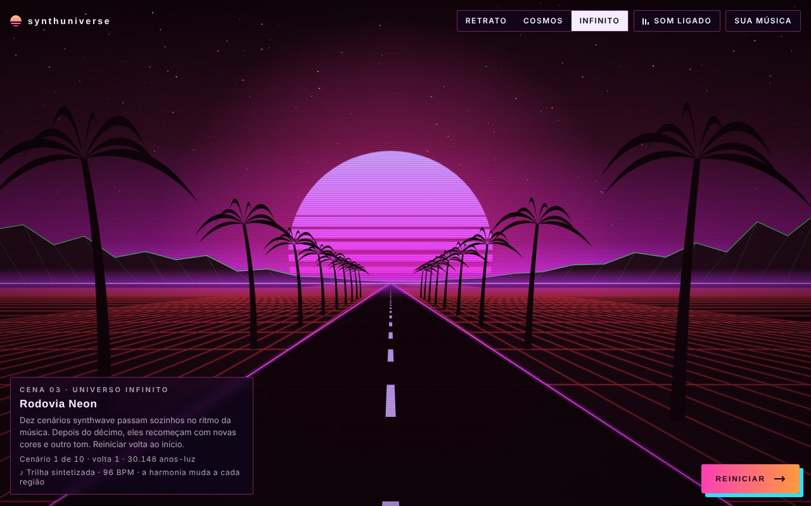<br>**1. Rodovia Neon** | 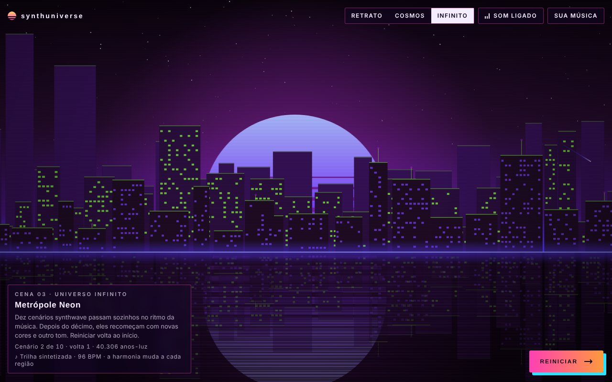<br>**2. Metrópole Neon** |
| 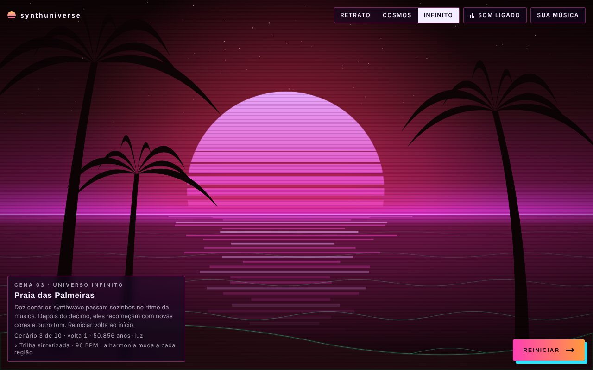<br>**3. Praia das Palmeiras** | 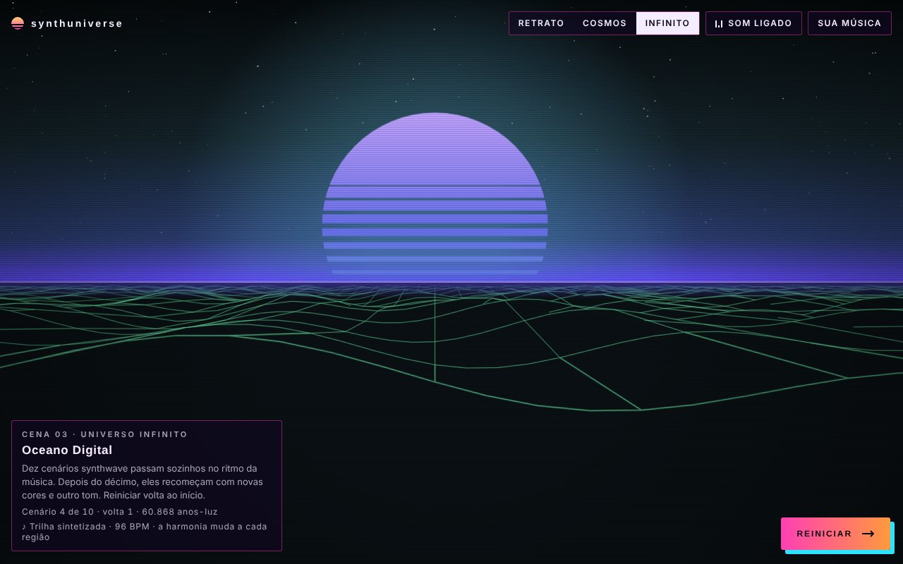<br>**4. Oceano Digital** |
| 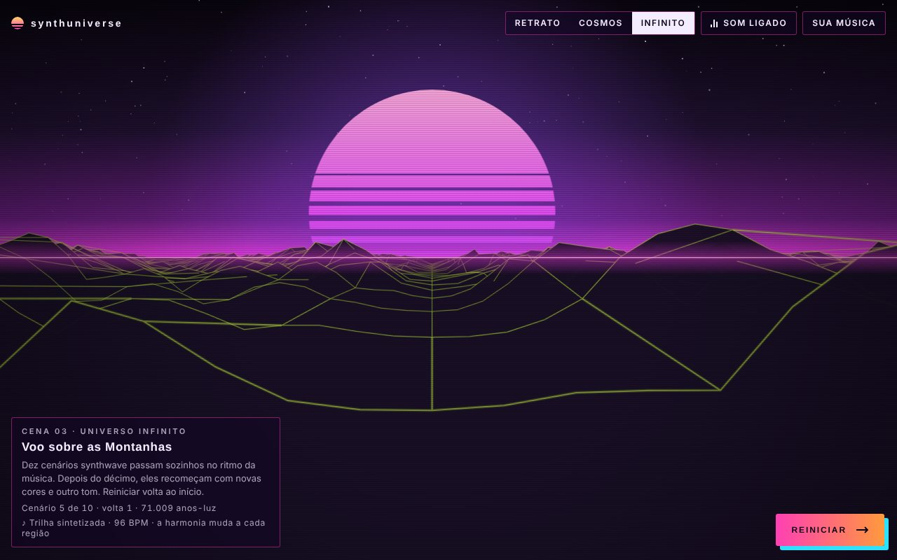<br>**5. Voo sobre as Montanhas** | 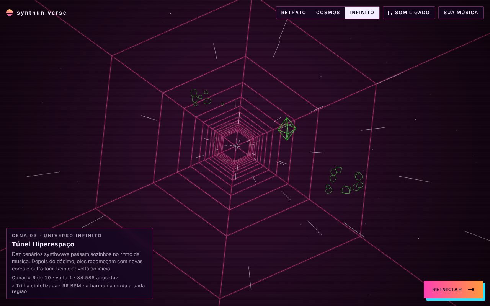<br>**6. Túnel Hiperespaço** |
| 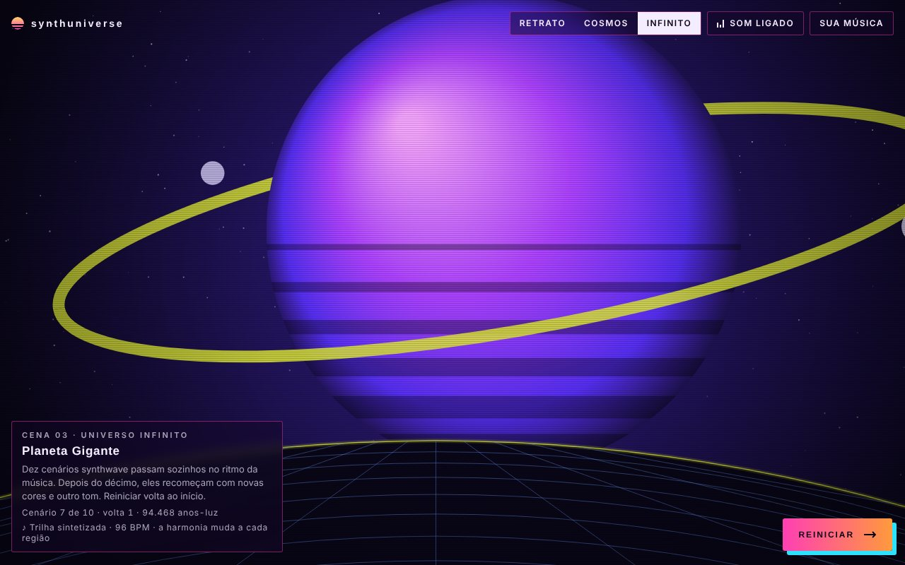<br>**7. Planeta Gigante** | 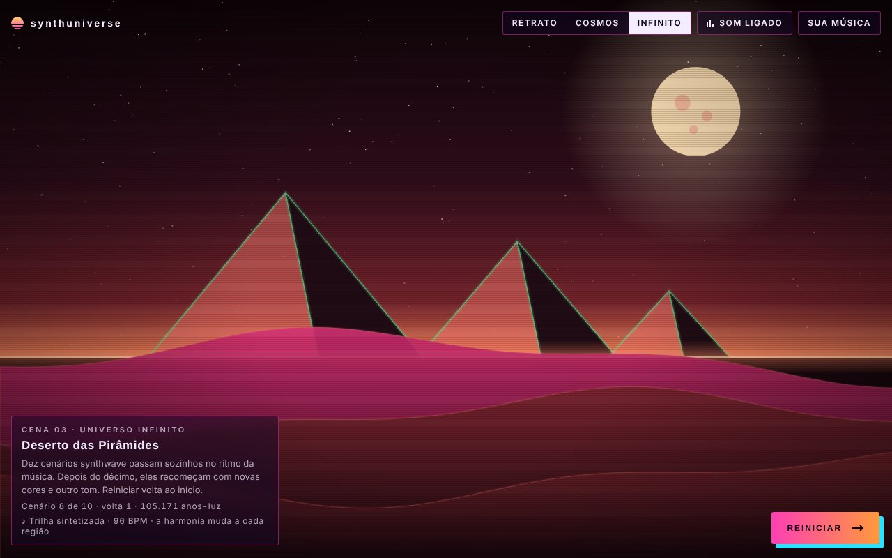<br>**8. Deserto das Pirâmides** |
| 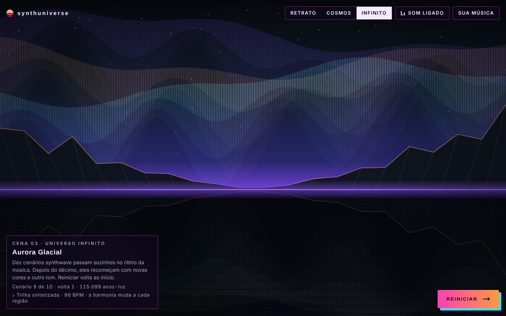<br>**9. Aurora Glacial** | 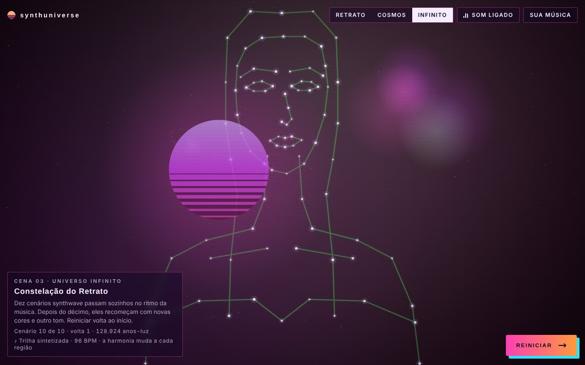<br>**10. Constelação do Retrato** |

> As capturas usam as fontes alternativas do site. No navegador, com acesso ao Google Fonts, os títulos aparecem em Syncopate e os textos em Chakra Petch.

## Arquivos

| Arquivo | Conteúdo |
|---|---|
| `index.html` | Estrutura, retrato em SVG e HUD |
| `style.css` | Tema, retrato, transições, HUD e responsividade |
| `script.js` | Som, animação do retrato, canvas, universo infinito e cenas |
| `docs/COMO-FUNCIONA.md` | Documentação completa da arquitetura |

## Como rodar

Abra `index.html` no navegador. Para servir localmente:

```bash
npx serve .
# ou
python3 -m http.server
```

## Trocar a música

No início de `script.js`:

```js
const CONFIG = { musicUrl: 'musica.mp3' };
```

Coloque o arquivo de áudio na mesma pasta. Deixe a string vazia para usar a trilha sintetizada. O visitante também pode carregar uma música pelo botão **Sua música**. Os navegadores só tocam áudio depois de um clique, por isso o som começa na primeira interação.

## Documentação

Para entender como tudo funciona (máquina de cenas, motor de som, renderização, regiões do universo infinito) e onde ajustar cada valor, leia [docs/COMO-FUNCIONA.md](docs/COMO-FUNCIONA.md).
