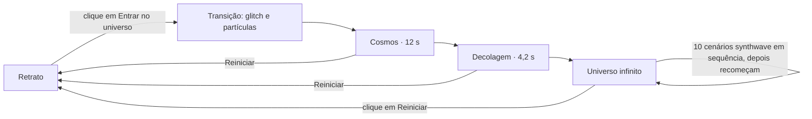

# Como o synthuniverse funciona

Este documento explica a arquitetura do site, o caminho que o visitante percorre e cada peça do código: o retrato em SVG, o motor de som, o desenho em canvas e o universo infinito. No fim há uma tabela com os valores mais fáceis de ajustar.

O projeto usa só HTML, CSS e JavaScript, sem bibliotecas nem etapa de build. A única dependência externa são duas fontes do Google Fonts.

---

## Sumário

1. [Visão geral](#1-visão-geral)
2. [Arquivos](#2-arquivos)
3. [O caminho do visitante](#3-o-caminho-do-visitante)
4. [Máquina de cenas](#4-máquina-de-cenas)
5. [O retrato (SVG)](#5-o-retrato-svg)
6. [O motor de som](#6-o-motor-de-som)
7. [O canvas: cosmos e decolagem](#7-o-canvas-cosmos-e-decolagem)
8. [O universo infinito](#8-o-universo-infinito)
9. [Paletas de cor](#9-paletas-de-cor)
10. [HUD e interação](#10-hud-e-interação)
11. [Laço principal](#11-laço-principal)
12. [Acessibilidade e desempenho](#12-acessibilidade-e-desempenho)
13. [Personalização rápida](#13-personalização-rápida)
14. [Como estender](#14-como-estender)

---

## 1. Visão geral

A página é um palco de tela cheia com quatro camadas empilhadas:

| Camada (de trás para frente) | Elemento | Papel |
|---|---|---|
| 0 | `<canvas id="space">` | Cosmos, decolagem e universo infinito |
| 1 | `.paper` | Fundo cinza-claro da cena 01, com granulado e o nome gigante "synth universe" |
| 2 | `.figure-pos` | O sol listrado pastel e o retrato em SVG |
| 3 | `.scan`, `.cosmos-title` | Scanlines e o título cromado da cena 02 |
| 4 | `.hud-top`, `.hud-bottom` | Logo, etapas, som, painel de informações e botão principal |

O atributo `data-scene` em `#app` controla o que aparece. O CSS reage a ele, por exemplo escondendo `.paper` fora do retrato. O JavaScript só troca esse atributo e anima o canvas.



---

## 2. Arquivos

| Arquivo | Conteúdo |
|---|---|
| `index.html` | Estrutura da página, o retrato em SVG (todas as formas e IDs animados) e o HUD |
| `style.css` | Tokens de cor e fonte, camadas, estilos do retrato, transições de entrada/saída, HUD, responsivo e movimento reduzido |
| `script.js` | Configuração, motor de som, animação do retrato, renderização do canvas, universo infinito, cenas, HUD e laço principal |

O `script.js` é dividido em blocos marcados com comentários:

| Bloco | O que faz |
|---|---|
| `CONFIGURAÇÃO DA MÚSICA` | `CONFIG.musicUrl` para usar sua própria faixa |
| `SOM` | Módulo `Sound`: síntese, sequenciador, efeitos, faixa própria, detecção de batidas |
| `RETRATO` | Sorriso, piscadas, olhar, respiração |
| `COSMOS` | Paletas, campo de estrelas, montanhas, sol |
| `sequência da viagem` | Estado `journey`, desenho do cosmos e da decolagem |
| `universo infinito` | Objetos espaciais (planetas, galáxias, notas, discos, portais etc.) |
| `dez cenas visuais` | Os 10 cenários, peças de desenho reutilizadas (céu, sol, grade, palmeiras, terreno, reflexo) e o retrato em constelação |
| `CENAS & HUD` | Transições entre cenas, textos do painel, eventos, laço principal |

---

## 3. O caminho do visitante

1. **Retrato (cena 01).** A mulher sorri de tempos em tempos, pisca e move os olhos. Passar o cursor ou tocar nela faz com que olhe direto e sorria.
2. **Primeiro clique.** Os navegadores só liberam áudio após uma interação, então o primeiro clique em qualquer lugar liga a trilha.
3. **"Entrar no universo".** Ela abre o sorriso, sofre um glitch com cores separadas (magenta e ciano), sai de cena e se dissolve em cerca de 560 partículas. O fundo cinza some e o canvas aparece com efeito de velocidade de dobra.
4. **Cosmos (cena 02).** Céu em degradê, sol listrado, montanhas em wireframe e grade neon em movimento. Depois de 12 s a viagem segue sozinha.
5. **Decolagem.** O título sobe e some, o sol afunda e a grade acelera. A câmera sobe, o horizonte desce para fora da tela e o espaço profundo aparece por cima.
6. **Universo infinito (cena 03).** Viagem contínua por **10 cenários synthwave** que passam sozinhos, em sequência, no ritmo da música. Depois do décimo, eles recomeçam ("volta 2", "volta 3"...) com novas cores e outro tom. O visitante não escolhe nada: tudo roda sozinho até ele clicar em **Reiniciar**.

---

## 4. Máquina de cenas

Há duas variáveis de estado:

- `scene`: `'portrait'`, `'cosmos'`, `'lift'` ou `'infinite'`. Controla o HUD e o que reage a cliques.
- `journey.phase`: `'idle'`, `'cosmos'`, `'lift'` ou `'infinite'`. É o relógio da viagem, avançado a cada quadro em `journey.t`.

| Função | Quando roda | O que faz |
|---|---|---|
| `toCosmos()` | Clique em "Entrar no universo" | Liga o som (nível 1), toca o "whoosh", anima a saída do retrato, solta as partículas e, após 1,75 s, inicia `journey.phase = 'cosmos'` |
| `startLift()` | `journey.t ≥ COSMOS_HOLD` | Fase de decolagem, já cria os primeiros objetos do espaço e lança estrelas cadentes |
| `startInfinite()` | `journey.t ≥ LIFT` | Som no nível 2, zera distância e regiões, chama `newZone()` |
| `restart()` | Botão "Reiniciar" | Volta ao retrato, som ao nível 0 (só pad e arpejo), harmonia original, limpa os objetos |

A variável `busy` impede cliques duplos durante as transições.

---

## 5. O retrato (SVG)

O retrato está dentro de `index.html`, num `viewBox` de 368 × 476 unidades, e é desenhado em camadas:

1. `#headBack`: cabelo de trás, rente à cabeça. Ele desce por trás dos ombros e o corpo esconde as pontas.
2. `#bodyG`: ombros, busto, pescoço, clavículas e a blusa com a borda neon. Fica dentro de um grupo com `scale(.88 1)` que estreita o tronco.
3. `#headFront`: rosto, sombras, sobrancelhas, olhos, nariz, boca e as mechas da frente, que repousam sobre o peito.

Alguns detalhes de construção:

- **Sombreamento monocromático.** Três tons de pele azulada (`.skin`, `.shade`, `.light`) e contorno em nanquim (`.ink`). As sombras ficam presas ao rosto, pescoço e corpo por `clipPath`.
- **Rosto levemente virado.** O lado direito do rosto é mais estreito. O olho e a sobrancelha desse lado são comprimidos com `scale(.86 1)`, e nariz e boca são deslocados alguns pixels.
- **Proporção do rosto.** As feições ficam num grupo com `scale(1 .85)` centrado na linha dos olhos.
- **Traços com pontas.** As mechas de brilho (`.tip`), sobrancelhas (`.brow`) e delineado (`.lid`) são formas preenchidas que afinam nas pontas, como pincelada.
- **Olhos.** Íris em degradê radial, pupila, dois reflexos de luz e a sombra da pálpebra sobre a íris.

### Animação (`applyFace`)

A cada quadro, `updatePortrait()` calcula três valores e `applyFace(s, bl, t)` aplica:

| Valor | Faixa | Efeito |
|---|---|---|
| `s` (sorriso) | 0 → 1 | Reescreve os caminhos `#lipUp`, `#lipLow` e `#mouthLine` (cantos sobem); mostra as dobras do sorriso; sobe a luz das bochechas e as sobrancelhas; aperta levemente os olhos |
| `bl` (piscada) | 0 → 1 → 0 em 0,17 s | Escala vertical dos grupos `#eyeN`/`#eyeF` |
| `P.gx`, `P.gy` (olhar) | pixels | Desloca as íris `#irisN`/`#irisF` |

O que mexe nesses valores:

- **Sorriso automático:** alterna entre sorriso pequeno (0,12) e grande (1) em intervalos aleatórios. Com a trilha tocando, sincroniza com as trocas de acorde a cada dois compassos.
- **Interação:** cursor sobre ela (`P.hover`) ou toque (`P.tapUntil`) forçam sorriso e olhar direto.
- **Olhar natural:** a cada 0,9 a 3,1 s, a íris faz uma pequena sacada perto do centro. Em 18% das vezes, ela desvia o olhar e volta.
- **Respiração e balanço:** o corpo sobe e desce 1,4 unidade e a cabeça oscila menos de 1 grau.

A saída e a volta da figura usam as animações CSS `leave` e `arrive` em `.figure`.

---

## 6. O motor de som

O módulo `Sound` usa a Web Audio API e gera toda a trilha em tempo real, sem arquivos de áudio.

### Cadeia de áudio

```
vozes ──► master ──► compressor ──► analisador ──► saída
  │                     ▲
  ├──► delay (3/16, realimentado, filtrado) ─┘
  └──► reverb (resposta ao impulso gerada com ruído)
```

### Sequenciador

- 96 BPM, em semicolcheias (`S16 = 60 / 96 / 4`), num ciclo de 4 compassos (64 passos).
- O agendamento usa a técnica de *lookahead*: a cada 25 ms, `tick()` agenda as notas dos próximos 120 ms no relógio do `AudioContext`. Assim o ritmo fica preciso mesmo se a tela travar.

### Vozes

| Voz | Síntese | Quando toca |
|---|---|---|
| `pad` | 2 dentes-de-serra desafinados por nota, filtro passa-baixa varrendo | Sempre, um acorde por compasso |
| `arp` | Onda quadrada com filtro que fecha rápido, enviada ao delay | Sempre, em colcheias |
| `kick` | Senoide com queda de frequência 160 → 42 Hz | Nível ≥ 1, em semínimas |
| `snare` | Ruído passa-alta + tom triangular, enviado ao reverb | Nível ≥ 1, tempos 2 e 4 |
| `hat` | Ruído passa-alta 7,5 kHz | Nível ≥ 1, contratempos |
| `bass` | Dente-de-serra com filtro ressonante | Nível ≥ 1, oitavas alternadas |
| `lead` | Dente-de-serra com vibrato (LFO), delay e reverb | Nível 2 (universo infinito) |
| `whoosh` | Ruído com filtro passa-faixa subindo + queda grave | Ao sair do retrato e ao decolar |

### Níveis e variações

- `setLevel(0 | 1 | 2)`: retrato = pad e arpejo; cosmos = + bateria e baixo; infinito = + melodia. Com faixa própria, o nível abre ou fecha um filtro: abafado no retrato, aberto no espaço.
- `setVariation(progressão, transposição)`: cada um dos 10 cenários tem a sua progressão (Am–F–C–G, Am–Em–F–G, Dm–B♭–F–C ou Am–G–F–E) e o seu tom. A cada volta completa, o tom ainda sobe ou desce um tom inteiro. A troca só acontece na virada do compasso, então nunca corta a música no meio.

### Sincronia com o visual

O sequenciador coloca eventos numa fila (`kick`, `snare`, `bar`) com o horário exato. O laço principal chama `Sound.poll()` e reage quando cada evento chega:

- `kick`: `pulse = 1` faz a grade, o sol e os portais pulsarem.
- `snare`: um flash suave no céu.
- `bar`: o retrato sorri, o cosmos lança estrelas cadentes e o infinito cria um portal a cada dois compassos (nos cenários espaciais).

Os cenários também leem os graves do analisador (`Sound.spectrum()`): o mar ondula mais alto, a aurora se estica e os cenários pulsam junto com a trilha.

Com uma **faixa própria**, não há fila de eventos. O `poll()` mede a energia dos graves no analisador e detecta batidas quando ela passa 25% da média recente. Se o som estiver desligado, um relógio interno gera pulsos a 96 BPM, `readAudio()` simula espectro e forma de onda, e notas do acorde são sorteadas no mesmo andamento. Assim o visual nunca fica parado.

### Faixa própria

`useTrack(url, nome)` cria um `<audio>` em loop, conecta-o ao mesmo master e desliga o sintetizador. Se o arquivo falhar, volta para a trilha sintetizada. A origem pode ser `CONFIG.musicUrl` ou o botão "Sua música", que usa um arquivo local via `URL.createObjectURL`.

Quando a aba fica oculta, o `AudioContext` é suspenso e a faixa é pausada. Tudo volta ao reabrir a aba.

---

## 7. O canvas: cosmos e decolagem

`drawSpace(dt)` roda a cada quadro enquanto `spaceOn` está ativo. Ele atualiza os valores que decaem com o tempo (`pulse`, `flash`, `warp`, mistura da paleta e paralaxe do mouse) e escolhe o que desenhar.

### Campo de estrelas (`drawStars`)

São 620 estrelas em coordenadas 3D (`x`, `y`, `z`), projetadas como `x/z`. Elas se aproximam reduzindo `z` e renascem no fundo. Com `warp` alto, viram riscos (efeito de dobra). Com `warp` baixo, cintilam.

### Cosmos (`drawCosmos(dt, L)`)

O parâmetro `L` (0 → 1) é o progresso da decolagem, suavizado por `ease`. Os elementos são desenhados nesta ordem:

1. **Céu**: degradê linear até o horizonte `HY = H × (0,64 + 0,8·L)`. Na decolagem o horizonte desce para fora da tela, como se a câmera inclinasse para cima.
2. **Estrelas.**
3. **Sol listrado**: desenhado num canvas auxiliar, de onde as faixas são recortadas com `destination-out` e rolam para baixo. Pulsa com o bumbo e afunda na decolagem.
4. **Montanhas**: duas camadas de picos gerados (`makeRidge`), mais altos nas laterais para deixar o vale do sol livre. Têm contorno neon e linhas verticais de wireframe.
5. **Grade**: linhas horizontais em perspectiva (`y = HY + h·0,85/z`) que avançam com `gridPhase`, mais linhas radiais a partir do ponto de fuga. Cada linha é desenhada duas vezes (larga e translúcida, depois fina) para imitar o brilho neon.
6. **Brilho do horizonte.**

Na decolagem, `warp` cresce na segunda metade e o universo infinito entra por cima, com opacidade crescente nos últimos 38% da fase.

---

## 8. O universo infinito

### Objetos

Cada objeto tem posição 3D e é projetado como as estrelas: tamanho na tela = `size / z × escala`. Os objetos nascem em `z = 4` (bem longe), se aproximam e somem ao passar da câmera. Eles aparecem e desaparecem com transparência gradual e são desenhados do mais distante para o mais próximo.

| Tipo | Como é desenhado |
|---|---|
| `planet` | Brilho externo, esfera com degradê radial (luz no alto à esquerda), faixas escuras no estilo synthwave e anel opcional em duas metades (atrás e na frente) |
| `star` | Sol gigante com as faixas animadas do cosmos |
| `galaxy` | Núcleo luminoso e ~170 pontos em dois braços espirais, girando e inclinados |
| `nebula` | Cinco nuvens de degradê radial somadas com `lighter` |
| `asteroid` | Grupo de 6 a 12 rochas irregulares (polígonos de 7 pontos) girando |
| `crystal` | Octaedro em wireframe girando em 3D, com brilho neon |
| `ring` | Portal neon centralizado que a câmera atravessa, com um anel tracejado girando |

### Os 10 cenários

Os cenários passam sozinhos, em ordem, sem nenhuma escolha do visitante. Cada um dura de 18 a 24 s e `newZone()` monta o próximo. O índice vem de `zoneN % 10` e a volta de `zoneN / 10`.

| # | Cenário | O que aparece | Como acompanha a música |
|---|---|---|---|
| 1 | Rodovia Neon | Estrada outrun rumo ao sol listrado, montanhas, grade e palmeiras passando dos dois lados | A estrada acelera e as palmeiras balançam no bumbo |
| 2 | Metrópole Neon | Skyline em três camadas com janelas acesas, antenas e reflexo na água | Antenas piscam no bumbo; o sol pulsa |
| 3 | Praia das Palmeiras | Pôr do sol no mar, reflexo tremulando, ondas, areia e palmeiras | Palmeiras balançam no ritmo; o reflexo tremula |
| 4 | Oceano Digital | Mar em malha wireframe ondulando até o horizonte | As ondas crescem com o grave |
| 5 | Voo sobre as Montanhas | Voo rasante por um cânion de montanhas em wireframe | A malha brilha no bumbo |
| 6 | Túnel Hiperespaço | Túnel poligonal (4 a 7 lados) com riscos de velocidade | O túnel acende no bumbo; portais a cada dois compassos |
| 7 | Planeta Gigante | Planeta anelado nascendo atrás de uma lua com grade, e duas luas em órbita | A grade da lua pulsa |
| 8 | Deserto das Pirâmides | Pirâmides neon sob a lua cheia, com dunas deslizando | As arestas das pirâmides brilham no bumbo |
| 9 | Aurora Glacial | Aurora sobre montanhas de gelo, refletida no lago | A aurora se estica com o grave |
| 10 | Constelação do Retrato | O retrato da cena 01 desenhado como constelação, linha por linha, sobre nebulosas | As estrelas do retrato acendem no bumbo |

Os cenários marcados como `land: true` (paisagens) escondem o campo de estrelas em 3D e os objetos espaciais, e desenham o próprio céu estrelado. Os outros (`objects: true`) mantêm planetas, galáxias, cristais e portais passando, com a mistura definida em `weights`.

Ao entrar em cada cenário, `newZone()` também:

- gera uma **paleta nova** dentro da faixa de matizes do cenário (`hue`), com transição de cerca de 4,5 s, para que nenhuma volta repita as cores;
- define a **harmonia** do cenário (progressão e tom) com `Sound.setVariation`;
- sorteia **ritmo de criação** e **velocidade**;
- dá um flash e um pequeno salto de dobra.

O cenário anterior continua desenhado enquanto some em 3 s (`prevZone`), então eles se fundem na troca. O avanço das paisagens usa a variável `travel`, que cresce mais rápido logo depois de cada bumbo.

**Peças reutilizadas.** As paisagens são montadas com funções comuns: `skyGrad` (céu), `skyStars` (estrelas cintilando), `sunAt` (sol listrado), `floorGrid` (grade neon), `horizonLine`, `palm` (palmeira), `terrain` (malha wireframe que avança, usada no oceano e nas montanhas) e `reflect` (espelha a cena na água com faixas de ondulação).

**Constelação do Retrato.** Os pontos vêm das coordenadas do próprio SVG do retrato (contorno do rosto, olhos, sobrancelhas, nariz, boca, mechas, pescoço, ombros e decote), com as mesmas transformações aplicadas no `index.html`.

O painel mostra "Cenário N de 10", o número da volta e a distância percorrida em anos-luz (um contador decorativo que acelera com o `warp`).

---

## 9. Paletas de cor

Todas as cores do canvas passam pela função `C(chave, alfa)`, que mistura duas paletas (`palFrom` → `palTo`) pelo fator `palK`. Trocar de paleta (`setPal`) primeiro "fotografa" a mistura atual e depois parte dela. Por isso uma troca no meio de outra nunca dá salto.

Cada paleta tem 12 chaves: `sky0..3` (céu), `sun0..2` (sol), `grid`, `ground`, `mount`, `edge` (contornos neon) e `star`.

- **Fixas** (`PAL`): Neon de Miami, Aurora Ciano e Ocaso Carmim. O cosmos usa a primeira.
- **Geradas** (`genPalette`): cada cenário sorteia o matiz dentro da sua faixa (`hue` em `SCENES`, por exemplo 300°–345° na Rodovia Neon). Sem faixa definida, o matiz cai em 80% das vezes entre ciano e magenta (175°–345°) e no resto entre vermelho e laranja (0°–30°), para manter o clima synthwave. As outras cores derivam por deslocamento de matiz e luminosidade. O `edge` usa o matiz complementar para contraste.

---

## 10. HUD e interação

| Elemento | Comportamento |
|---|---|
| Etapas (Retrato · Cosmos · Infinito) | Indicador; a etapa atual é marcada com `aria-current="step"` |
| Som | Primeiro clique liga; depois alterna mudo |
| Sua música | Carrega um arquivo de áudio local |
| Painel de informações | Cena, nome do cenário ou região, dica, distância (só no infinito) e trilha atual. Usa `aria-live="polite"` |
| Botão principal | "Entrar no universo" no retrato; "Reiniciar" nas demais cenas |
| Clique no céu | Estrela cadente e faísca, só um efeito: não muda o cenário nem interrompe a viagem |
| Mouse | Paralaxe suave no cosmos e no infinito |

As cores do HUD mudam com a cena via variáveis CSS (`--fg`, `--chip-bg` etc.): tinta escura sobre o cinza do retrato e lilás claro sobre o espaço.

---

## 11. Laço principal

A função `frame()` roda a cada quadro, por `requestAnimationFrame`, e executa nesta ordem:

1. Calcula `dt`, limitado a 50 ms para não dar saltos após travadas, e avança o relógio `T`.
2. `Sound.poll(onEvent)` processa os eventos musicais que chegaram.
3. Gera pulsos de reserva se o som estiver desligado.
4. Avança `journey.t` e dispara `startLift()` e `startInfinite()` na hora certa.
5. No infinito, atualiza distância, transições de região, criação de objetos e portais de reserva.
6. Anima o retrato, se ele estiver visível.
7. Desenha o canvas, se o espaço estiver ativo.

---

## 12. Acessibilidade e desempenho

- **Movimento reduzido:** com `prefers-reduced-motion`, a saída e a volta do retrato viram um simples esmaecer, e o balanço e a respiração param. O warp, a grade e os objetos ficam mais lentos.
- O retrato tem `role="img"` e descrição em `aria-label`. Os elementos decorativos usam `aria-hidden`.
- Os botões têm foco visível em ciano.
- O canvas usa no máximo 2× a densidade de pixels da tela. O retrato só é animado quando visível, e o canvas só é desenhado fora do retrato.
- O brilho neon é feito com traços sobrepostos, não com `shadowBlur`, que é caro em celulares.

---

## 13. Personalização rápida

| O que mudar | Onde | Padrão |
|---|---|---|
| Sua música | `CONFIG.musicUrl` em `script.js` | `''` (trilha sintetizada) |
| Tempo da cena 02 | `COSMOS_HOLD` | `12` s |
| Duração da decolagem | `LIFT` | `4.2` s |
| Duração de cada cenário | `dur: 18 + Math.random()*6` em `newZone()` | 18–24 s |
| Ordem, nomes, cores, harmonia e objetos dos cenários | `SCENES` | 10 cenários |
| Andamento da trilha | `BPM` no módulo `Sound` | `96` |
| Progressões de acordes | `PROGS` no módulo `Sound` | 4 progressões |
| Paletas fixas | `PAL` | 3 paletas |
| Faixa de matizes geradas | `genPalette()` | 175°–345° e 0°–30° |
| Cores da pele e do traço | `.skin`, `.shade`, `.light`, `.ink` em `style.css` | tons azulados |
| Largura do tronco | `scale(.88 1)` antes de `#bodyG` em `index.html` | `.88` |
| Altura do rosto | `scale(1 .85)` dentro de `#headFront` | `.85` |
| Tamanho do retrato na tela | `.figure-pos` em `style.css` | `min(95vh, 122vw)` |

---

## 14. Como estender

**Novo tipo de objeto no universo infinito**

1. Em `spawnObj()`, adicione um ramo `else if (type === 'meuTipo')` que defina `o.size`, `o.x`, `o.y` e os dados próprios do objeto.
2. Em `DRAW`, adicione `meuTipo(o, x, y, s){ ... }`. Ela recebe o centro na tela (`x`, `y`) e o raio (`s`). Use `C('chave', alfa)` para as cores.
3. Inclua `meuTipo` com um peso no `weights` dos cenários espaciais em `SCENES` onde ele deve aparecer.

**Novo cenário**

1. Em `FEAT`, adicione `meuCenario(z, cx, cy, bass, M){ ... }`. A função recebe o centro da tela, o nível de grave (0–1) e o menor lado da tela (`M`). A transparência da transição já vem aplicada. Use as peças prontas (`skyGrad`, `sunAt`, `floorGrid`, `terrain`, `reflect`...), `pulse` para o bumbo e `travel` para o avanço.
2. Adicione um item em `SCENES` com `name`, `feature: 'meuCenario'`, `land` (paisagem ou espaço), `objects`, `hue`, `prog`, `tr` e, se for espacial, `weights`. O ciclo passa a ter um cenário a mais automaticamente.

**Nova progressão de acordes**

Adicione `{ ch: [[...],[...],[...],[...]], rt: [...] }` em `PROGS`. Cada acorde é uma lista de três notas MIDI (60 = Dó central) e `rt` traz as fundamentais do baixo, uma oitava abaixo.
